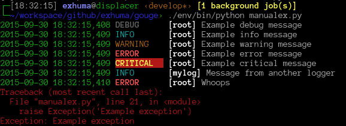

gouge
=====

Formatters for the Python :mod:`logging` module. gouge gives console output
a uniform, coloured layout that is easy to scan, and writes the same
records as JSON Lines, CSV or XML for machines. It works with the standard
library alone: no wrapper API, no new logger class. Its only dependency is
`colorama <https://pypi.org/project/colorama/>`_.

Install
-------

.. code-block:: console

   $ pip install gouge

gouge needs Python 3.11 or newer.

Example
-------

Set up the root logger with
:meth:`Simple.basicConfig <gouge.colourcli.Simple.basicConfig>`, then log
as usual:

>>> import logging
>>> from gouge.colourcli import Simple
>>> handlers = Simple.basicConfig(
...     level=logging.DEBUG
... )
>>> log = logging.getLogger("app")
>>> log.info("Server started")
2026-10-27 13:34:48,899 INFO       [app] Server started
>>> log.warning("Disk 91% full")
2026-10-27 13:34:48,899 WARNING    [app] Disk 91% full

On a terminal, the level, logger name and tracebacks are coloured:

      DEBUG in grey, INFO in cyan, WARNING in yellow, ERROR in red and
      CRITICAL in yellow on red, logger names in bold, and a traceback in
      red.

   Output of :class:`~gouge.colourcli.Simple` in a terminal.

Features
--------

Readable console output
   :class:`~gouge.colourcli.Simple` aligns the level names, colours each
   level, puts the logger name in brackets and colours tracebacks, with
   file names of your own code highlighted.

Configuration files
   Every option works from :func:`logging.config.dictConfig` and YAML
   files, including pre-formatters given as dotted paths. No subclass is
   needed.

Extra attributes
   Attributes passed with ``extra={...}`` or set by a filter, such as a
   correlation ID, are appended as ``key=value`` pairs with
   ``show_extra``.

Structured output
   :class:`~gouge.parseable.JSONLog` writes one JSON object per line,
   extra attributes and OpenTelemetry trace IDs included.
   :class:`~gouge.parseable.CSVLog` and :class:`~gouge.parseable.XMLLog`
   write CSV and XML.

uvicorn support
   :func:`~gouge.uvicorn.capture_uvicorn` routes uvicorn's records through
   your handlers, and :func:`~gouge.preformatters.uvicorn_access` colours
   its access log.

Colour control
   ``NO_COLOR`` and ``FORCE_COLOR`` are honoured. Without them, colour is
   stripped when the output is not a terminal.

Level shifting
   :class:`~gouge.filters.ShiftingFilter` raises or lowers the level of
   records from a noisy library.

Project status
--------------

gouge is actively maintained and stable (Development Status
"Production/Stable"). The API has been stable since 2.0. See
`Compatibility`_ for the versioning and deprecation policy.

Compatibility
-------------

gouge follows `Semantic Versioning <https://semver.org/spec/v2.0.0.html>`_.
It supports the CPython versions which have not reached their end of life
(see `endoflife.date <https://endoflife.date/python>`_), currently 3.11 to
3.15, the versions in ``requires-python`` and the package classifiers. When
a Python version reaches its end of life, the next minor release may raise
the minimum version.

A change is breaking when it can make working user code fail or behave
differently. This includes:

- removing or renaming a public name, parameter or attribute,
- changing the layout of a formatter's output, such as the order of its
  fields or the names of its keys,
- raising an exception where the code did not raise before,
- changing a return type.

Breaking changes are released only in a major version. Before gouge removes
anything, a minor release deprecates it: the old name emits a
:class:`DeprecationWarning`, and the :doc:`changelog` names the
replacement. The removal comes no earlier than the next major release.

Contents
--------

:doc:`getting-started`
   Console output with :class:`~gouge.colourcli.Simple` and its options.

:doc:`configuring`
   Configure gouge with :func:`logging.config.dictConfig` or a YAML file.

:doc:`pre-formatters`
   Rewrite the messages of a logger before they are formatted.

:doc:`extra-attributes`
   Show extra attributes and correlation IDs.

:doc:`structured-output`
   Write JSON Lines, CSV or XML.

:doc:`uvicorn`
   Format uvicorn's server and access logs.

:doc:`colour`
   Switch colour on or off.

:doc:`shifting-levels`
   Change the level of records from a library.

:doc:`api/index`
   Every public module, class and function.

:doc:`changelog`
   Changes in every release.

.. toctree::
   :hidden:

   getting-started
   configuring
   pre-formatters
   extra-attributes
   structured-output
   uvicorn
   colour
   shifting-levels
   api/index
   changelog
