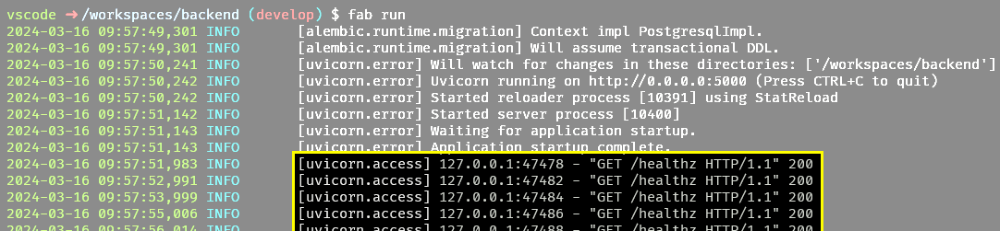
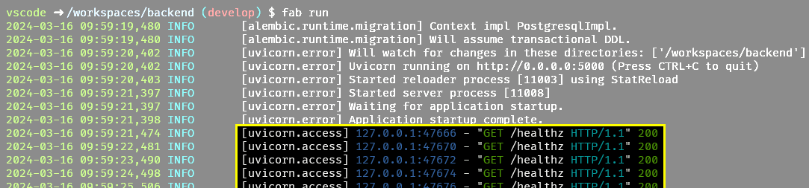

Pre-formatters
==============

.. versionadded:: 2.1

A pre-formatter rewrites the message of a record before
:class:`~gouge.colourcli.Simple` formats it, for example to colour parts of
a message. It is a function that takes the message text and returns the new
text.

gouge ships one pre-formatter,
:func:`~gouge.preformatters.uvicorn_access`, for the access log of the
uvicorn web server. Without it, the message of an access log line has one
colour:

      and status code all in the default text colour.

   uvicorn access log without a pre-formatter.

With it, the client address, method, path, HTTP version and status code
each get their own colour:

      method in green, the path in white, the HTTP version in cyan and the
      status code in green.

   uvicorn access log with
   :func:`~gouge.preformatters.uvicorn_access`.

Write a pre-formatter
---------------------

Map logger names to lists of pre-formatters with the ``pre_formatters``
option. They apply only to records of exactly that logger, not to its
children, and run in the order given:

>>> import logging
>>> from gouge.colourcli import Simple
>>> def shout(message):
...     return message.upper()
>>> def mark(message):
...     return f"** {message} **"
>>> handlers = Simple.basicConfig(
...     pre_formatters={
...         "app.alerts": [shout, mark],
...     },
... )
>>> logging.getLogger("app.alerts").warning(
...     "Disk full"
... )
2026-10-27 13:34:48,899 WARNING    [app.alerts] ** DISK FULL **
>>> logging.getLogger("app").warning(
...     "Disk full"
... )
2026-10-27 13:34:48,899 WARNING    [app] Disk full

Pre-formatters receive the message with its arguments already merged in,
and must return a :class:`str`. ``msg`` and ``args`` of the record are not
changed, so other formatters still see the original message.

Refer to a pre-formatter by name
--------------------------------

.. versionadded:: 2.3

Instead of a function, give its dotted path. gouge imports it once, when
the formatter is created. Both ``"package.module.function"`` and
``"package.module:function"`` work:

>>> formatter = Simple(
...     pre_formatters={
...         "uvicorn.access": [
...             "gouge.preformatters.uvicorn_access",
...         ],
...     },
... )
>>> formatter.pre_formatters
{'uvicorn.access': [<function uvicorn_access at ...>]}

A path that cannot be imported raises a :class:`ValueError` naming it:

>>> Simple(
...     pre_formatters={"app": ["myapp.missing"]}
... )
Traceback (most recent call last):
  ...
ValueError: Cannot import pre-formatter 'myapp.missing': No module named 'myapp'

Dotted paths make pre-formatters usable in configuration files. See
:doc:`configuring`.

Colour and pre-formatters
-------------------------

The colour codes a pre-formatter adds are removed together with the
others when colour is off, for example when ``NO_COLOR`` is set. A
pre-formatter can add colour codes unconditionally. See :doc:`colour`.
